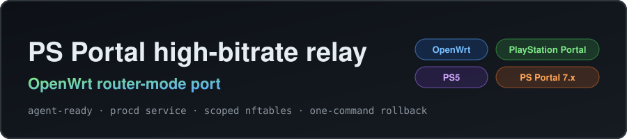

<p align="center">
  <a href="https://github.com/TimRChen/psportal-highbitrate-openwrt"></a>
</p>

# PS Portal high-bitrate relay — OpenWrt router-mode port

**Run the PlayStation Portal high-bitrate relay directly on your OpenWrt router.**
No PC, no Raspberry Pi, no always-on container.

This is an **OpenWrt router-mode port** of [atameric/ps5-portal-high-bitrate](https://github.com/atameric/ps5-portal-high-bitrate)
(MIT). Upstream supports macOS, Windows, native Linux, Raspberry Pi, Proxmox LXC
and Docker macvlan — router firmware is explicitly **not** a supported upstream
target. This port makes the relay run on the LAN gateway itself.

**Read in:** English · [简体中文](README.zh-CN.md)

<p align="center">
  <a href="https://github.com/TimRChen/psportal-highbitrate-openwrt/stargazers"></a>
  <a href="https://github.com/TimRChen/psportal-highbitrate-openwrt/network/members"></a>
  <a href="https://github.com/TimRChen/psportal-highbitrate-openwrt/releases"></a>
  <a href="LICENSE"></a>
  <a href="https://github.com/TimRChen/psportal-highbitrate-openwrt/actions/workflows/ci.yml"></a>
  
  
  
</p>

> **Status: experimental.** Verified on one router (Cudy TR3000 v1, MediaTek
> MT7981, ImmortalWrt 24.10) and one Portal firmware layout that upstream
> validated (7.1.7). Not a jailbreak, not a 4K unlock, no guaranteed latency
> improvement. Keep a recovery path in mind on hardware you rely on.

---

## Start here

| What you have | Where to go |
|---|---|
| **An OpenWrt / ImmortalWrt router** as your home gateway | [Quick start](#quick-start): five commands, ~10 minutes. |
| **A coding agent** (Claude Code, Codex, Gemini CLI, …) | [Agent skill](#agent-skill): one skill folder, JSON probes, no guessing. |
| **No coding agent and just want the relay** | [Quick start](#quick-start) runs by hand too. |
| **Curious how it works first** | [How it works](#how-it-works) and [What you get](#verified-result). |
| **Portal resolution dropped / relay not patching** | [Troubleshooting](#troubleshooting) and [docs/troubleshooting.md](docs/troubleshooting.md). |

---

## How it works

The Portal and the PS5 negotiate a session startup packet that contains a
plaintext bitrate field (`25000`). The relay temporarily redirects the
**Portal → PS5 control direction** through itself, rewrites that one field
(`25000` → `65000` for profile `65`), then leaves the session alone. The
**PS5 → Portal video path is never relayed** — it keeps the direct LAN path.

```
   ┌─────────────── the router itself runs the relay ────────────────┐
   │                                                                 │
 Portal ──ARP──▶  control packets  ──▶  patch bitrate byte  ──▶  PS5
        (spoofed)                    (profile 65: 25000→65000)
   │                                                                 │
 Portal ◀───────────── video (direct L2, never relayed) ◀───────────┘
```

| Piece | What it does |
|---|---|
| **ARP spoof** | Makes the Portal believe the PS5 lives at the router's MAC. Only the Portal's ARP entry is changed, and it is restored on every exit path. |
| **Userspace patch** | `scapy` inspects `Portal → PS5` frames, rewrites the LaunchSpec bitrate byte, recomputes the UDP checksum and re-injects the frame. |
| **Scoped nftables guard** | A router must keep `ip_forward=1`; this project adds one table, `inet portal_bitrate_guard`, that drops only the duplicate `Portal → PS5` copy the kernel would forward. No global firewall, sysctl or firmware changes. |
| **procd service** | Run once (`portal-bitrate session`) or permanently; the service restarts cleanly and removes its table on stop/crash. |

Why a port at all? Upstream refuses to start with `net.ipv4.ip_forward=1`. A
gateway must have it. The port solves that with the scoped table instead of
relaxing the safety rule. Details in
[docs/openwrt-port-notes.md](docs/openwrt-port-notes.md).

---

## Quick start

```sh
# 0) requirements: OpenWrt 23.05+ with fw4/nftables, root shell, ≥35 MB free on /overlay
opkg update
opkg install python3 python3-pip
pip3 install --break-system-packages scapy==2.6.1

# 1) install the port (from a git checkout or extracted release)
sh install.sh

# 2) enroll your devices (both awake; interface is the LAN bridge)
portal-bitrate configure --interface br-lan \
  --ps5-ip 192.168.1.100 --portal-ip 192.168.1.101 --profile 65

# 3) baseline: no mutation, proves the path works
#    Start it, wait for "BASELINE READY", then reconnect the Portal inside the window
portal-bitrate baseline --seconds 240

# 4) trial: apply the mutation to the next fresh session
portal-bitrate session 300

# 5) keep it (patches every new session automatically)
/etc/init.d/portal-bitrate enable
/etc/init.d/portal-bitrate start
```

During steps 3 and 4 the Portal must be **disconnected and reconnected inside the
window**. The relay prints `BASELINE READY` / `AUTO READY` first; the counters
then confirm the patch. Use `portal-bitrate status` to watch them.

**Daily use (recommended):** on weak CPUs, skip the permanent service and arm a
window before playing instead — `portal-bitrate arm 180`, reconnect the Portal
when it says `ready`, and the relay restores the direct path by itself.

---

## Verified result

Real output from the reference device after two reconnects:

```json
// /var/lib/portal-bitrate/status.json
{
  "mode": "active",
  "profile": "65",
  "counts": {
    "forwarded_out": 121276,
    "forwarded_bytes": 11000000,
    "modified_packets_including_retransmits": 2,
    "unique_modified_startups": 2
  },
  "last_mutation": "2026-11-08T06:15:49Z"
}
```

```json
// sh skill/scripts/verify.sh
{"ok": true, "problems": [], "relay_instances": 2, "guard_table_present": true,
 "arp_restored": true, "baseline_receipt": true, "state": "running"}
```

`modified_packets_including_retransmits` and `unique_modified_startups` grow by
one per **fresh** session. They are the only proof the relay did its job; picture
quality still has to be checked on the Portal by a human.

---

## Supported hardware

| Platform | Status |
|---|---|
| **OpenWrt / ImmortalWrt 24.10 (fw4)** | ✅ Reference target: Cudy TR3000 v1, MediaTek MT7981, aarch64. |
| **OpenWrt / ImmortalWrt 23.05 (fw4)** | ✅ Expected; Python 3 ≥ 3.9 and `nft` required. |
| **OpenWrt 22.03 and older (iptables/fw3)** | ⚠️ Not tested — the guard table is nftables-only. |
| **Router with `kmod-veth` unavailable** | ✅ Not a problem: this port does not use veth/netns at all. |
| **PC / Raspberry Pi / LXC / Docker** | Use [upstream](https://github.com/atameric/ps5-portal-high-bitrate) — it is the better tool there. |

Tested with one Portal firmware layout (upstream: 7.1.7). Other firmware may not
match the packet heuristic; nothing breaks, the counters simply stay at zero.

---

## CLI reference

| Command | What it does |
|---|---|
| `portal-bitrate configure ...` | Enroll PS5 + Portal (ARP-verified), write `/etc/portal-bitrate/auto-config.json`. |
| `portal-bitrate baseline [--seconds N]` | No-mutation run; writes the baseline receipt required before active mode. |
| `portal-bitrate arm [secs]` | **Recommended for playing.** Background window (default 180 s): waits for `AUTO READY`, then you reconnect the Portal; the patch applies once and the direct path is restored. |
| `portal-bitrate session [secs]` | Foreground version of `arm` (Ctrl+C restores). |
| `portal-bitrate run [--seconds N]` | Foreground relay, active mode (continuous while running). |
| `portal-bitrate status` | State + counters from `/var/lib/portal-bitrate/status.json`. |
| `portal-bitrate stop` | Write the persistent stop marker. |
| `portal-bitrate repair` | After a crash: corrective ARP + remove the guard table. |
| `portal-bitrate guard` | Emergency: delete only the scoped nftables table. |
| `portal-bitrate verify` | Check the baseline receipt matches this config and code. |
| `/etc/init.d/portal-bitrate enable\|start\|stop\|disable` | procd service control. |

Full details and safety rules: [docs/openwrt-port-notes.md](docs/openwrt-port-notes.md).

---

## Agent skill

The repo is built to be driven by an AI agent end to end:

| File | Purpose |
|---|---|
| [`AGENTS.md`](AGENTS.md) | Ground rules, hard gates, success criteria, reporting format. |
| [`skill/SKILL.md`](skill/SKILL.md) | Step-by-step playbook with a diagnostics decision tree. |
| [`skill/manifest.json`](skill/manifest.json) | Machine-readable requirements, steps and verification. |
| [`skill/scripts/detect.sh`](skill/scripts/detect.sh) | Read-only environment probe → JSON (`ok`, `reasons`, details). |
| [`skill/scripts/install.sh`](skill/scripts/install.sh) | Idempotent install (prerequisites + this repo). |
| [`skill/scripts/configure.sh`](skill/scripts/configure.sh) | Non-interactive enrollment with IPv4 validation. |
| [`skill/scripts/verify.sh`](skill/scripts/verify.sh) | Read-only state check → JSON, including ARP restoration. |
| [`skill/scripts/rollback.sh`](skill/scripts/rollback.sh) | Stop, remove, restore, post-check. |

Agent loop:

```sh
sh skill/scripts/detect.sh                       # stop if ok=false
sh skill/scripts/install.sh
sh skill/scripts/configure.sh --ps5-ip <IP> --portal-ip <IP> --profile 65
portal-bitrate baseline --seconds 240            # human reconnects inside the window
portal-bitrate session 300                       # human reconnects again
sh skill/scripts/verify.sh                       # ok must be true
```

The skill enforces: only the scoped nftables table, one relay instance, always
verify recovery, never claim 4K or latency gains, never publish the user's
MACs/IPs. See [`AGENTS.md`](AGENTS.md).

---

## Troubleshooting

The full list is in [docs/troubleshooting.md](docs/troubleshooting.md). The three
that matter most:

- ⚠️ **`ERROR: IPv4 forwarding is enabled.`** — the router-mode env is missing.
  For the procd service, `env` is a single list:
  `procd_set_param env PORTAL_BITRATE_ROUTER_MODE=1 PYTHONUNBUFFERED=1`.
  Two separate lines overwrite each other.
- 🖥️ **Portal stutters and drops to 720p/360p** — usually the router's CPU, not
  the relay. On OpenClash routers disable streaming auto-select
  (`uci set openclash.config.stream_auto_select=0`), close LuCI OpenClash tabs,
  check `iwinfo rax0 assoclist` for a 20 MHz fallback, and keep the PS5's RSSI
  above −65 dBm. On weak CPUs prefer `portal-bitrate session` over the service.
- 🔁 **Portal cannot reach the PS5 after an unclean kill** — the spoofed ARP
  entry is stale: `portal-bitrate repair`. It also expires on its own.

---

## Questions people ask

<details>
<summary><b>Is this safe for my network?</b></summary>

It touches exactly one nftables table (`inet portal_bitrate_guard`), which it
creates and removes itself, plus the Portal's ARP entry, which is restored on
every exit path and expires on its own. It never edits `ip_forward`, DNS, DHCP or
`inet fw4`, and never flashes firmware. A hard kill can leave the Portal briefly
unable to reach the PS5 — `portal-bitrate repair` fixes that.

</details>

<details>
<summary><b>Will the relay make streaming laggy?</b></summary>

The relay only carries `Portal → PS5` control traffic; video never passes through
it. Measured overhead on the reference MT7981 was ~3 % CPU. If you do see lag,
the usual cause is CPU saturation from other router services (OpenClash
streaming auto-select, open LuCI pages) — see Troubleshooting. `session` mode
also restores the direct path after patching, so nothing runs during play.

</details>

<details>
<summary><b>Which bitrate profile should I pick?</b></summary>

Start with `65`. `100` and `200` are experimental and may stutter. The target is
what the PS5 is asked for; it is **not** measured video throughput.

</details>

<details>
<summary><b>Does it work on a router without veth support?</b></summary>

Yes. Upstream container/LXC deployments need veth and netns; this port avoids
both — it ARP-spoofs on the LAN bridge and re-injects frames from the host
namespace, with the kernel's duplicate drop handled by the scoped table.

</details>

<details>
<summary><b>The Portal shows a network-warning icon but streaming works — is it the relay?</b></summary>

Usually not. If `portal-bitrate status` says the relay is stopped, it cannot be
involved. The most common LAN-side cause is **half-open IPv6**: the router
advertises IPv6 addresses (ULA prefix / RA) without an IPv6 uplink, so clients
try IPv6 first, fail, fall back to IPv4, and may keep a warning indicator. Check
with `ip -6 route show default` (empty = no uplink) and `uci show network |
grep ula_prefix`; if an address is advertised with no default route, disable
LAN IPv6. `skill/scripts/detect.sh` flags this as `ipv6_half_open`. Full steps:
[docs/troubleshooting.md](docs/troubleshooting.md).

</details>

<details>
<summary><b>Will it survive a reboot?</b></summary>

Yes when the service is enabled (`/etc/init.d/portal-bitrate enable`). `/var` is
tmpfs on OpenWrt, so the baseline receipt is also mirrored to
`/etc/portal-bitrate/auto-baseline.json` and read back from there after a reboot.
If both copies are missing (firmware upgrade, code change), re-run the baseline;
the init script refuses to start instead of crash-looping.

</details>

<details>
<summary><b>Where are my devices' MACs stored?</b></summary>

In `/etc/portal-bitrate/auto-config.json`, written by `configure`. It is ignored
by git, printed nowhere by the scripts, and never uploaded.

</details>

---

## Limits and safety

- **Experimental.** One upstream-validated Portal firmware layout (7.1.7). Other
  firmware may not match; no corruption, just no patch.
- **No 4K, no guaranteed latency improvement.** Target bitrate ≠ real bitrate.
- **One-way relay only.** Video keeps the direct path by design.
- **Not affiliated** with Sony, PlayStation, the upstream author or OpenWrt.
- **Recovery:** `portal-bitrate repair` (ARP + table), `portal-bitrate guard`
  (table only), `sh uninstall.sh` (full removal, keeps config unless `--purge`).

---

## Restore / uninstall

```sh
/etc/init.d/portal-bitrate stop
/etc/init.d/portal-bitrate disable
sh uninstall.sh            # keeps /etc/portal-bitrate/auto-config.json
sh uninstall.sh --purge    # removes the enrollment too
```

After removal: no `portal_auto.py` process, no `inet portal_bitrate_guard` table,
and the Portal/PS5 ARP entries are back to the real MACs.

---

## Credits and related projects

- **[atameric/ps5-portal-high-bitrate](https://github.com/atameric/ps5-portal-high-bitrate)**
  — the relay design, the LaunchSpec offset-334 heuristic and the 65/100/200
  profiles. MIT, © 2026 atameric. This repository is a port, not a fork of the
  design.
- **[wchwawa/better-portal](https://github.com/wchwawa/better-portal)** — a guided
  TUI around the same upstream approach, useful reference for verification flow.
- The OpenWrt adaptation (router mode, scoped nftables guard, procd, agent skill)
  is maintained by [@TimRChen](https://github.com/TimRChen).

Contributions are welcome — especially router models and Portal firmware reports.
Read [`AGENTS.md`](AGENTS.md) if you drive changes with an agent, and
[`docs/troubleshooting.md`](docs/troubleshooting.md) before filing an issue.

---

## License

MIT. Upstream copyright preserved — see [`LICENSE`](LICENSE) and
[`NOTICE.md`](NOTICE.md). Independent community software; “PlayStation”, “PS5”
and “PlayStation Portal” are trademarks of Sony Interactive Entertainment Inc.
