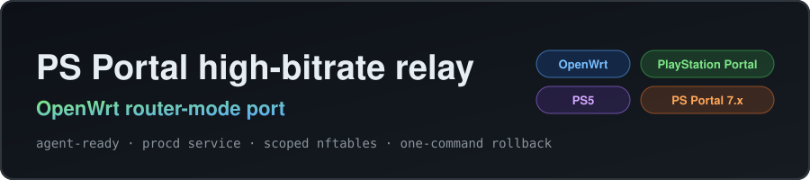

<p align="center">
  <a href="https://github.com/TimRChen/psportal-highbitrate-openwrt"></a>
</p>

# PS Portal 高码率中继 —— OpenWrt 路由模式移植

**把 PlayStation Portal 高码率中继直接跑在 OpenWrt 路由器上。**
不需要额外的电脑、树莓派或常开容器。

本项目是 **[atameric/ps5-portal-high-bitrate](https://github.com/atameric/ps5-portal-high-bitrate)**
（MIT）的 **OpenWrt 路由模式移植**。原项目支持 macOS、Windows、原生 Linux、
树莓派、Proxmox LXC 和 Docker macvlan——**明确不支持路由器固件**。本移植让中继
跑在局域网网关（路由器本身）上。

**阅读语言：** [English](README.md) · 简体中文

<p align="center">
  <a href="https://github.com/TimRChen/psportal-highbitrate-openwrt/stargazers"></a>
  <a href="https://github.com/TimRChen/psportal-highbitrate-openwrt/network/members"></a>
  <a href="https://github.com/TimRChen/psportal-highbitrate-openwrt/releases"></a>
  <a href="LICENSE"></a>
  <a href="https://github.com/TimRChen/psportal-highbitrate-openwrt/actions/workflows/ci.yml"></a>
  
  
</p>

> **状态：实验性。** 仅在一台路由器（Cudy TR3000 v1，MediaTek MT7981，ImmortalWrt 24.10）
> 和上游验证过的 Portal 固件布局（7.1.7）上测试过。不是破解、不解锁 4K、
> 不保证降低延迟。在你依赖的设备上操作前，请先想好回滚方式。

---

## 从这里开始

| 你的情况 | 去哪里 |
|---|---|
| **有一台 OpenWrt / ImmortalWrt 作为主路由** | [快速开始](#快速开始)：5 条命令，约 10 分钟。 |
| **用 AI Agent（Claude Code / Codex / Gemini CLI 等）操作** | [Agent 技能](#agent-技能)：一个 skill 目录，JSON 探测，不用猜。 |
| **没有 Agent，只想用** | 同样走[快速开始](#快速开始)，手动执行即可。 |
| **想先搞清楚原理** | [工作原理](#工作原理) 和 [实测结果](#实测结果)。 |
| **Portal 掉分辨率 / 中继没改包** | [故障排查](#故障排查) 和 [docs/troubleshooting.md](docs/troubleshooting.md)。 |

---

## 工作原理

Portal 与 PS5 在建立会话时会协商一个启动包，其中含明文的码率字段（`25000`）。
中继临时把 **Portal → PS5 控制方向**引流到路由器自身，改写该字段
（profile `65`：`25000` → `65000`），随后退出该会话。**PS5 → Portal 的视频
路径从不过中继**，始终走局域网直连。

```
   ┌─────────────── 中继直接跑在路由器上 ───────────────┐
   │                                                   │
 Portal ──ARP──▶  控制包  ──▶  修改码率字段  ──▶  PS5
        (ARP 劫持)              (65 档: 25000→65000)
   │                                                   │
 Portal ◀──────────── 视频（二层直连，永不过中继）◀────┘
```

| 组件 | 作用 |
|---|---|
| **ARP 劫持** | 让 Portal 以为 PS5 在路由器的 MAC 上。只改 Portal 一侧的 ARP 表项，任何退出路径都会还原。 |
| **用户态改包** | `scapy` 抓 `Portal → PS5` 帧，改写启动包码率字节，重算 UDP 校验和后再注入。 |
| **Scoped nftables 护栏** | 路由器必须保持 `ip_forward=1`；本项目只新增一张表 `inet portal_bitrate_guard`，仅丢弃内核会转发的那份 `Portal → PS5` 重复副本。不动全局防火墙、sysctl 和固件。 |
| **procd 服务** | 可以按需跑（`portal-bitrate session`）或常驻；服务重启干净，停止/崩溃时删除自己的表。 |

为什么要移植？上游在 `net.ipv4.ip_forward=1` 时会拒绝启动，而网关必然开启转发。
本移植用 scoped 表解决这个冲突，而不是放宽安全规则。详见
[docs/openwrt-port-notes.md](docs/openwrt-port-notes.md)。

---

## 快速开始

```sh
# 0) 依赖：OpenWrt 23.05+ 且使用 fw4/nftables，root shell，/overlay 剩余 ≥35MB
opkg update
opkg install python3 python3-pip
pip3 install --break-system-packages scapy==2.6.1

# 1) 安装（在 git 仓库或解压后的目录中执行）
sh install.sh

# 2) 登记设备（两台设备都要在线；接口为局域网网桥）
portal-bitrate configure --interface br-lan \
  --ps5-ip 192.168.1.100 --portal-ip 192.168.1.101 --profile 65

# 3) 基线测试：不修改任何包，验证通路
#    启动后等日志出现 "BASELINE READY"，然后在窗口内断开并重连 Portal
portal-bitrate baseline --seconds 240

# 4) 主动试验：对下一个新会话改包
portal-bitrate session 300

# 5) 常驻（每个新会话自动改包）
/etc/init.d/portal-bitrate enable
/etc/init.d/portal-bitrate start
```

第 3、4 步中，**必须在窗口内断开并重新连接 Portal**。中继会先打印
`BASELINE READY` / `AUTO READY`，之后由计数器确认是否改包成功。
用 `portal-bitrate status` 观察。

---

## 实测结果

参考设备重连两次后的真实输出：

```json
// /var/lib/portal-bitrate/status.json
{
  "mode": "active",
  "profile": "65",
  "counts": {
    "forwarded_out": 121276,
    "forwarded_bytes": 11000000,
    "modified_packets_including_retransmits": 2,
    "unique_modified_startups": 2
  },
  "last_mutation": "2026-11-08T06:15:49Z"
}
```

每次**新会话**，`modified_packets_including_retransmits` 和
`unique_modified_startups` 各 +1。它们是中继确实工作的唯一证据；
画质仍需人工在 Portal 上确认。

---

## 支持设备

| 平台 | 状态 |
|---|---|
| **OpenWrt / ImmortalWrt 24.10（fw4）** | ✅ 参考环境：Cudy TR3000 v1，MediaTek MT7981，aarch64。 |
| **OpenWrt / ImmortalWrt 23.05（fw4）** | ✅ 预期可用；需要 Python ≥3.9 和 `nft`。 |
| **OpenWrt 22.03 及更旧（iptables/fw3）** | ⚠️ 未测试——护栏表依赖 nftables。 |
| **没有 `kmod-veth` 的路由器** | ✅ 不受影响：本移植完全不用 veth/netns。 |
| **PC / 树莓派 / LXC / Docker** | 请用[上游项目](https://github.com/atameric/ps5-portal-high-bitrate)，在那些平台上它更合适。 |

仅在一种 Portal 固件布局（上游为 7.1.7）上验证过。其他固件可能匹配不上
握手包特征：不会有副作用，只是计数不增长。

---

## 命令参考

| 命令 | 作用 |
|---|---|
| `portal-bitrate configure ...` | 登记 PS5 + Portal（ARP 校验），写入 `/etc/portal-bitrate/auto-config.json`。 |
| `portal-bitrate baseline [--seconds N]` | 无修改运行；生成主动模式所需的基线回执。 |
| `portal-bitrate session [秒数]` | 按需窗口（默认 120 秒）：给下一个新会话改包，随后恢复直连。 |
| `portal-bitrate run [--seconds N]` | 前台运行中继（主动模式，持续拦截）。 |
| `portal-bitrate status` | 查看状态与计数器。 |
| `portal-bitrate stop` | 写入停止标记。 |
| `portal-bitrate repair` | 崩溃后救援：纠正 ARP + 删除护栏表。 |
| `portal-bitrate guard` | 应急：只删除 scoped nft 表。 |
| `portal-bitrate verify` | 校验基线回执与当前配置/代码是否匹配。 |
| `/etc/init.d/portal-bitrate enable\|start\|stop\|disable` | procd 服务控制。 |

完整细节与安全规则见 [docs/openwrt-port-notes.md](docs/openwrt-port-notes.md)。

---

## Agent 技能

本仓库从设计上就面向 AI Agent 自动操作：

| 文件 | 作用 |
|---|---|
| [`AGENTS.md`](AGENTS.md) | 操作守则、硬性门槛、成功判定、汇报格式。 |
| [`skill/SKILL.md`](skill/SKILL.md) | 分步操作手册 + 故障决策树。 |
| [`skill/manifest.json`](skill/manifest.json) | 机器可读的依赖、步骤与验证条件。 |
| [`skill/scripts/detect.sh`](skill/scripts/detect.sh) | 只读环境探测 → JSON（`ok`、`reasons`、明细）。 |
| [`skill/scripts/install.sh`](skill/scripts/install.sh) | 幂等安装（依赖 + 本仓库）。 |
| [`skill/scripts/configure.sh`](skill/scripts/configure.sh) | 非交互登记，含 IPv4 严格校验。 |
| [`skill/scripts/verify.sh`](skill/scripts/verify.sh) | 只读状态校验 → JSON，含 ARP 还原检测。 |
| [`skill/scripts/rollback.sh`](skill/scripts/rollback.sh) | 停止、卸载、恢复并复查。 |

Agent 标准流程：

```sh
sh skill/scripts/detect.sh                       # ok=false 就停
sh skill/scripts/install.sh
sh skill/scripts/configure.sh --ps5-ip <IP> --portal-ip <IP> --profile 65
portal-bitrate baseline --seconds 240            # 人工在窗口内重连 Portal
portal-bitrate session 300                       # 再次人工重连
sh skill/scripts/verify.sh                       # ok 必须为 true
```

技能内置的安全约束：只碰自己的 nft 表、单实例运行、停止后必须验证恢复、
禁止声称 4K / 降低延迟、禁止输出用户 MAC/IP。详见 [`AGENTS.md`](AGENTS.md)。

---

## 故障排查

完整清单见 [docs/troubleshooting.md](docs/troubleshooting.md)。最关键的三个：

- ⚠️ **`ERROR: IPv4 forwarding is enabled.`** —— 没进入路由模式。procd 的
  `env` 是单个列表：
  `procd_set_param env PORTAL_BITRATE_ROUTER_MODE=1 PYTHONUNBUFFERED=1`。
  写两行会互相覆盖。
- 🖥️ **Portal 卡顿、掉到 720p/360p** —— 通常是路由器 CPU 被打满，不是中继。
  OpenClash 用户请关闭「流媒体自动选路」
  （`uci set openclash.config.stream_auto_select=0`），关掉 LuCI 的 OpenClash
  页面，用 `iwinfo rax0 assoclist` 检查是否掉到 20MHz，并确保 PS5 信号优于
  −65dBm。CPU 较弱时优先用 `portal-bitrate session` 而不是常驻服务。
- 🔁 **异常终止后 Portal 连不上 PS5** —— ARP 表项残留：`portal-bitrate repair`。
  它也会在几十秒内自动过期。

---

## 常见问题

<details>
<summary><b>对我的网络安全吗？</b></summary>

只动一张 nftables 表（`inet portal_bitrate_guard`，由它自己创建和删除），以及
Portal 的 ARP 表项（任何退出路径都会还原，也会自动过期）。不会改
`ip_forward`、DNS、DHCP 或 `inet fw4`，不会刷固件。极端情况下强制 kill 可能
让 Portal 短暂连不上 PS5，`portal-bitrate repair` 即可恢复。

</details>

<details>
<summary><b>中继会让串流变卡吗？</b></summary>

中继只走 `Portal → PS5` 的控制流量，视频不经过它。参考设备（MT7981）实测
CPU 开销约 3%。如果确实变卡，通常是路由器上其他服务把 CPU 打满了（OpenClash
流媒体自动选路、开着的 LuCI 页面）。按需 `session` 模式在改包后立即恢复直连，
游玩期间没有任何额外开销。

</details>

<details>
<summary><b>该选哪个码率档位？</b></summary>

先试 `65`。`100` 和 `200` 是实验档，可能卡顿。这里的数字是向 PS5 请求的目标
值，**不是**实测视频码率。

</details>

<details>
<summary><b>没有 veth 的路由器能用吗？</b></summary>

能。上游的 LXC/容器方案需要 veth 和 netns，本移植两者都不用——在局域网网桥上
做 ARP 劫持，从主机命名空间重新注入帧，内核那一份重复副本由 scoped 表丢弃。

</details>

<details>
<summary><b>重启路由器后还在吗？</b></summary>

启用服务后（`/etc/init.d/portal-bitrate enable`）会开机自启。中继不需要重新登记：
它读取 `/etc/portal-bitrate/auto-config.json` 并校验基线回执，这两个文件都在
overlay 上，正常重启不会丢。

</details>

<details>
<summary><b>我的设备 MAC 存在哪？</b></summary>

在 `/etc/portal-bitrate/auto-config.json`，由 `configure` 写入。它被 git 忽略，
脚本不会打印，也不会外传。

</details>

---

## 限制与安全

- **实验性**：只在一种上游验证过的 Portal 固件布局（7.1.7）上验证。其他固件
  可能匹配不上，不会损坏什么，只是不会改包。
- **不解锁 4K、不保证降低延迟**：目标码率 ≠ 实际码率。
- **只做单向中继**：视频按设计走直连。
- **非官方项目**：与 Sony、PlayStation、上游作者和 OpenWrt 均无关联。
- **恢复手段**：`portal-bitrate repair`（ARP + 表）、`portal-bitrate guard`
  （只删表）、`sh uninstall.sh`（完整卸载，默认保留配置，`--purge` 一并删除）。

---

## 恢复 / 卸载

```sh
/etc/init.d/portal-bitrate stop
/etc/init.d/portal-bitrate disable
sh uninstall.sh            # 保留 /etc/portal-bitrate/auto-config.json
sh uninstall.sh --purge    # 连登记信息一起删除
```

卸载后应满足：没有 `portal_auto.py` 进程、没有 `inet portal_bitrate_guard` 表、
Portal/PS5 的 ARP 表项回到真实 MAC。

---

## 相关项目与致谢

- **[atameric/ps5-portal-high-bitrate](https://github.com/atameric/ps5-portal-high-bitrate)**
  —— 中继设计、LaunchSpec 偏移 334 的启发式、65/100/200 档位均来自上游。
  MIT，© 2026 atameric。本仓库是移植，不是对设计的重新发明。
- **[wchwawa/better-portal](https://github.com/wchwawa/better-portal)**
  —— 同一上游方案的引导式 TUI，验证流程可参考。
- OpenWrt 适配部分（路由模式、scoped nftables 护栏、procd、Agent 技能）由
  [@TimRChen](https://github.com/TimRChen) 维护。

欢迎提交路由器型号与 Portal 固件兼容性报告。用 Agent 驱动改动请先读
[`AGENTS.md`](AGENTS.md)；提 issue 前请先看
[`docs/troubleshooting.md`](docs/troubleshooting.md)。

---

## 许可证

MIT。上游版权声明已保留——见 [`LICENSE`](LICENSE) 与 [`NOTICE.md`](NOTICE.md)。
本项目为独立社区软件；“PlayStation”“PS5”“PlayStation Portal” 是 Sony Interactive
Entertainment Inc. 的商标。
